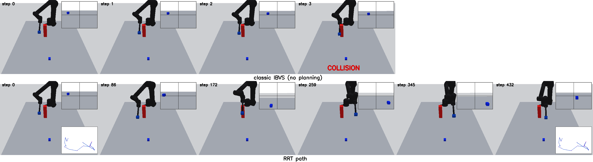

# Assignment 3: Visual Servoing and Image-Space Path Planning with a UR5

This assignment builds on the lectures on **Visual Servoing** and **RRT**. A camera is mounted on the
end-effector of a UR5 robot. Your job is to make a target appear in the camera image exactly as you
want it: at a chosen position and with a chosen size. This is described by the **desired feature vector**
`s* = [x*, y*, a*]`: the target's centroid (x*, y*) in pixels from the image centre and its area a* in
pixels². You choose s* yourself (TODO 0).

You first build image-based visual servoing (IBVS) and make it track a moving target. Then you watch
IBVS fail when an obstacle is in the way, and fix that by planning a path in image space with RRT and RRT*.

The simulation, robot, camera, plots and GUI are provided. You choose s* (TODO 0) and implement
**8 TODOs, two per task**.

## Learning Objectives

- Describe a visual-servoing goal with image features and choose a reachable one
- Derive and use the interaction matrix of image features
- Write a classic IBVS control law and see the error converge exponentially
- Track a moving target by estimating and compensating its motion
- Understand why IBVS alone fails near obstacles, and why planning helps
- Grow an RRT in image space, and improve it into RRT* (choose parent, rewire)

## Before you start: choose s* (TODO 0)

**Where:** `config/experiment_config.py`, the line `GOAL_FEATURE = None` (marked `TODO 0`).

**What:** replace `None` with your own values, `GOAL_FEATURE = np.array([x*, y*, a*])`:

| | Meaning | Allowed | Recommended |
|:---:|:---|:---:|:---:|
| x* | horizontal position of the target's centroid, px from the image centre (right is +) | −320 … 320 | 0 … 100 |
| y* | vertical position of the target's centroid, px from the image centre (down is +) | −240 … 240 | 0 … 80 |
| a* | area of the target in the image, px²; larger = camera closer (area ∝ 1/distance²) | > 0 | 2000 … 3000 |

All four tasks use the same s*. Every s* inside the recommended ranges is reachable in all tasks. Outside
them the target may leave the image or, in Tasks 3–4, the arm cannot reach the pose without coming too
close to the obstacle (the program warns you). To see where the target starts and where your s* is,
run `python main.py --task1 --preview` (and `--task3`): it prints the start feature s0 and draws your
s* in the camera image. Until you set s*, every task stops with a message pointing to TODO 0.

## Tasks

**Task 1: IBVS, static target.** Implement the interaction matrix and the classic law
`v = −λ L⁺ e`. The camera servos from the start pose to the goal, and the error decays exponentially.

**Task 2: IBVS, moving target.** The target now moves on a circle. Classic IBVS always lags behind.
Estimate how much of the feature change comes from the target itself, and cancel it in the control law.

**Task 3: Image-space RRT.** The program first runs your Task 1 controller in a scene with a pillar.
IBVS drives straight towards the goal and hits the pillar. To get around it, plan first: grow an RRT in
image space, where every node also stores the robot configuration that sees that image, so collisions,
field of view and occlusion can be checked. The robot then follows the planned path with
trajectory-tracking IBVS, which is the Task 2 law with the planned feature velocity as the "motion".

**Task 4: Image-space RRT*.** The RRT path works but wanders. Turn RRT into RRT*: give each new node the
cheapest parent among its neighbours, and rewire neighbours through it when that shortens their path.

| TODO | Task | File → function | Implement |
|:---:|:---:|:---|:---|
| 0 | all | `config/experiment_config.py` → `GOAL_FEATURE` | Your desired feature `s* = [x*, y*, a*]` |
| 1 | 1 | `kinematics.py` → `InteractionMatrix.compute` | 3×6 interaction matrix of `s = [xc, yc, a]` |
| 2 | 1 | `ibvs.py` → `ibvs_camera_velocity` | `v = −λ L⁺ e` |
| 3 | 2 | `ibvs.py` → `estimate_target_motion` | `∂ê/∂t = (s_k − s_{k−1})/Δt − L_{k−1} v_{k−1}` |
| 4 | 2 | `ibvs.py` → `compensated_camera_velocity` | `v = −L⁺ (λ e + ∂ê/∂t)` |
| 5 | 3 | `planner.py` → `_extend` | One RRT step towards a random feature |
| 6 | 3 | `visualizer.py` → `draw_rrt_tree` | Draw the tree and the path from start to goal |
| 7 | 4 | `planner.py` → `_choose_parent` | Cheapest valid parent among the neighbours |
| 8 | 4 | `planner.py` → `_rewire` | Re-route neighbours through the new node |

Each TODO block contains step-by-step hints. Replace its `raise NotImplementedError(...)` line with your code.
Find them with `grep -rn "TODO [0-8]" --include=*.py .`. Every task needs TODO 0 and the TODOs of
the tasks before it.

## Setup

```bash
git clone <repository-url> assignment3
cd assignment3
python3 -m venv .venv
source .venv/bin/activate        # Windows: .venv\Scripts\activate
pip install -r requirements.txt
python -m unittest tests.test_framework     # should pass before you start
```
On Ubuntu, if `venv` fails, run `sudo apt install python3-venv` first.

## Running

```bash
python main.py --task1 --preview   # look at a scene and your s* (works before any TODO)

python -m unittest tests.test_task1 -v   # test your TODOs (likewise test_task2 ... test_task4)

python main.py --task1             # run a task with the GUI
python main.py --task2
python main.py --task3
python main.py --task4
python main.py --all --headless    # all tasks, no windows (about 2 minutes)
```

The GUI shows the robot in 3-D, the camera image with the error, and, in Tasks 3–4, the tree growing
live in feature space. The final path is drawn in red. Rotate the 3-D view with **Ctrl + left-drag**.
Outputs are written to `results/<task>/`, with all tasks summarised in `results/summary.md`.

## Expected Results

Reference outputs are in `results_reference/`. They were made with the target centred and an area of
3000 px²; with your own s* the numbers change, but the behaviour should be the same.

| Task | Expected |
|:---|:---|
| 1 | error 1563 px → about 3 px in 10 s |
| 2 | steady tracking error about 62 px (classic) → about 10 px (compensated) |
| 3 | classic IBVS hits the pillar; the RRT path reaches the goal with 0 collisions |
| 4 | RRT* path about 3× shorter than RRT (cost about 1900 vs 6200), 0 collisions |




